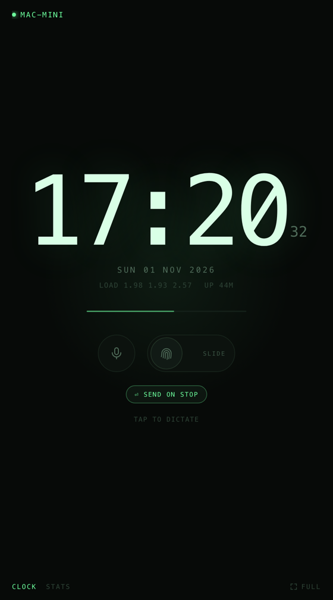
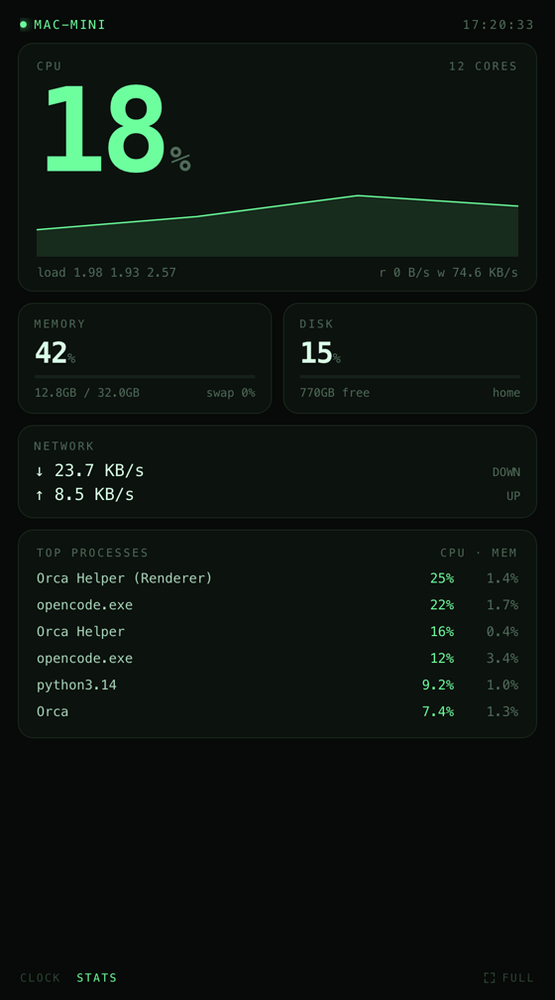
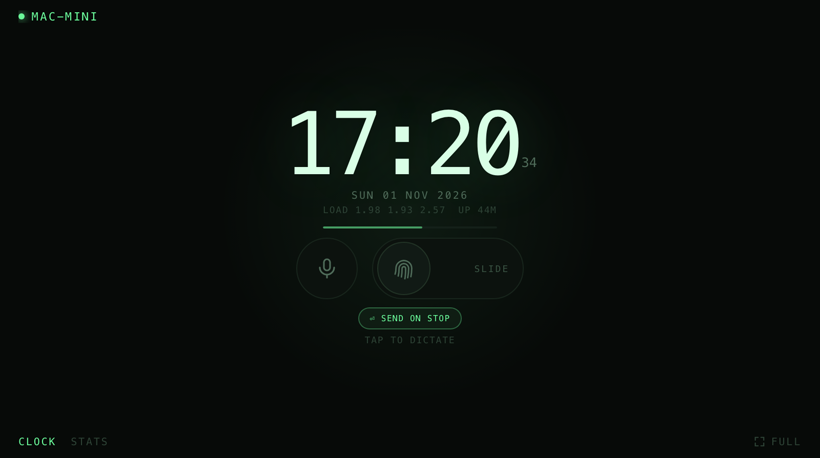

<div align="center">

# DeskNook

**A spare phone on your desk, showing your Mac's vitals — dark, green, and completely offline.**

One Python file, one HTML file, two tiny Swift helpers. No framework, no build
step, no account, no cloud.

[](https://github.com/pickleRickSudo/desknook/actions/workflows/ci.yml)
[](LICENSE)
[](https://www.python.org)



</div>

---

## What it does

Point an old phone at `http://your-mac.local:7777` and leave it on your desk.
It becomes a clock, a system monitor, and a two-button remote for your Mac.

| | |
|---|---|
| **Clock** | Big monospace time, date, load average, uptime, and a thin bar that fills over each minute |
| **Stats** | CPU with a live sparkline, memory, disk, network, disk I/O, battery, and the top six processes |
| **Dictation** | A mic button that presses ⌥Z on the Mac, starting or stopping macOS Dictation — then optionally presses Return to send |
| **Phrase slider** | A slide-to-confirm knob that types the contents of `phrase.txt` into whatever app is frontmost, then presses Return |

The page is a single HTML file with inline CSS and JS. It polls a JSON endpoint
once a second, so there is nothing to compile and nothing to install on the
phone beyond a browser.

<table>
<tr>
<td></td>
<td></td>
</tr>
</table>

## Why this exists

I wanted a desk clock that also told me when my machine was busy, on hardware
that was already sitting in a drawer. Everything I found wanted a cloud account,
a subscription, or a browser tab that dims after two minutes.

This is the version that fits on a spare phone: it runs from a launch agent, it
reconnects on its own, it never phones home, and the whole thing is under
1,500 lines including the CSS.

## Requirements

- **macOS** for the buttons (the helpers use CoreGraphics + Accessibility).
  The clock and stats pages work on any OS that runs Python — CI proves it on Linux.
- **Python 3.8+** with [`psutil`](https://github.com/giampaolo/psutil).
- **Xcode Command Line Tools** (`xcode-select --install`) — only to compile the
  two Swift helpers. Skip it if you don't want the buttons.
- **A phone** and a modern browser. Tested on Android Chrome; any browser that
  can add a home-screen shortcut will do.

## Install

```sh
git clone https://github.com/pickleRickSudo/desknook.git
cd desknook
./install.sh
```

The script is idempotent. It:

1. checks Python and installs `psutil` for your user if it's missing,
2. creates `phrase.txt` from the example (`chmod 600`, and keeps Spotlight out),
3. compiles `dictate.swift` and `typephrase.swift` into `bin/`,
4. writes a launch agent (`local.desknook`) that runs the server under
   `caffeinate -s`, so it starts at login and restarts if it dies,
5. prints the URL to open on your phone.

Then two one-time steps, because macOS will not let an app grant itself these:

**1. Point Dictation at ⌥Z** — System Settings → Keyboard → Keyboard Shortcuts →
Dictation → turn on, set the shortcut to ⌥Z. (The helper sends Option-Z; if you
prefer another shortcut, edit the key codes in `dictate.swift`.)

**2. Grant Accessibility** — System Settings → Privacy & Security → Accessibility,
then add both binaries:

```
/path/to/desknook/bin/dictate
/path/to/desknook/bin/typephrase
```

Each gets its own entry, and **rebuilding a binary invalidates its grant** — you
have to remove and re-add it. Without the grant the endpoints answer
`{"error":"accessibility"}` and the UI says *needs Accessibility on the Mac*.
Everything else keeps working.

### Manual install, no agent

```sh
python3 -m pip install --user psutil
./install.sh --no-agent      # builds helpers + phrase.txt, skips the agent
python3 server.py            # http://localhost:7777
```

### Kiosk setup on the phone

Open the URL, then *Add to Home Screen*. Tap the ⛶ button in the corner (or add
the page to Chrome's fullscreen list) to hide the browser chrome. Turn off
auto-lock for that app, or keep the charger connected — the page is a static
image most of the time, so it sips power.

## The two buttons

Both send **synthetic keystrokes to whatever app is frontmost on the Mac**. That
is the whole trick, and it is also the thing to be careful about. Nothing is
recorded or streamed: the Mac's own Dictation engine does the listening, exactly
as if you had pressed the key yourself.

### Dictation

Tap the mic: the server runs `bin/dictate`, which posts Option-Z — macOS treats
it as the Dictation shortcut. Tap again to stop.

When **⏎ SEND ON STOP** is lit, the stop half of the toggle also presses Return,
about 400 ms later, so a dictated message gets submitted instead of sitting in
the input box. It is only sent on the stop, never the start, because Return in a
terminal runs a command.

State is tracked by the server, not read from macOS — there is no public API for
"is dictation listening right now". The toggle also expires after 35 s of
silence, so a lost tap can't leave it stuck in the wrong state.

Measured latency: tap → key ~80 ms, key → Dictation listening ~600 ms. The UI
holds a short amber "starting" state before it goes red, so the button matches
what is actually happening.

### The phrase slider


This one is a deliberate oddity: **a slider, not a button.**

Put whatever text you like in `phrase.txt`:

```sh
echo "Running late, start without me." > phrase.txt
```

Then slide the fingerprint knob to the right. Once it passes 60% of the track
the knob turns green, a haptic tick confirms it is armed, and releasing types
the phrase into the frontmost app one character at a time (25 ms each), then
presses Return.

**Why a slider?** It sits one thumb-width from the mic. A tap that fires a
phrase into an open terminal is a genuinely bad accident, and a tap is the
easiest thing to do by mistake. Requiring a 60% drag costs about a second and
makes a stray touch inert — there is no click handler at all, so a tap does
nothing whatsoever.

It is not a confirmation dialog: once past the threshold, releasing fires
immediately. It stops fumbles, not a deliberate slide.

Behaviour worth knowing:

- **It types into the frontmost app.** With a chat app focused, it sends a
  message. With a terminal focused, it runs the line as a command.
- Newlines and runs of whitespace collapse to single spaces, so a stray line
  break can't submit halfway through.
- Empty file → nothing typed, `phrase.txt is empty` in the UI.
- Capped at 1000 bytes, one job at a time (a second slide gets `busy`).
- `--no-enter`, `--delay`, and `--dry-run` exist on the helper; the endpoint
  only exposes `?dry=1`, which counts characters and presses nothing.

The knob is the one piece of UI with a confirmation threshold, and the safest
thing to put in `phrase.txt` is something you would not mind a stranger reading.

## Using it

| Gesture | Result |
|---|---|
| Swipe left / right, or tap the footer tabs | Switch between clock and stats |
| Tap the mic | Start / stop Dictation on the Mac |
| Tap **⏎ SEND ON STOP** | Toggle whether stopping dictation also sends |
| Drag the fingerprint knob | Type `phrase.txt`, then Return |
| ⛶ | Fullscreen |

Landscape gets its own layout rules: the clock scales down, the stats page
scrolls, and the circles stay circular. Portrait is the intended orientation.

## Configuration

Everything is environment variables or a file — no config parser, no YAML.

| Variable | Default | Meaning |
|---|---|---|
| `PORT` | `7777` | HTTP port |
| `HOST` | `0.0.0.0` | Bind address. `127.0.0.1` makes it local-only |
| `PHRASE_FILE` | `./phrase.txt` | Where the slider reads from |

Constants worth knowing, at the top of `server.py`:

| Name | Default | Meaning |
|---|---|---|
| `REFRESH` | `1.0` | Seconds between samples |
| `MIC_IDLE_TIMEOUT` | `35.0` | Seconds before the mic state expires |
| `SUBMIT_DELAY_MS` | `400` | Wait before Return, so Dictation can finish |
| `TYPE_DELAY_MS` | `25` | Per-character delay. Raise it if chars drop |
| `TYPE_MAX_CHARS` | `1000` | Refuse larger phrase files |

## HTTP API

The API is small enough to drive from anything — a Stream Deck, a shell script,
another dashboard.

| Endpoint | Method | Does |
|---|---|---|
| `/` | GET | The HTML page |
| `/api/stats` | GET | The latest sample as JSON |
| `/api/mic` | GET | `{"active": bool}` — the server's view of dictation |
| `/api/dictate` | POST | Toggle dictation. `?enter=1` also presses Return on stop |
| `/api/phrase` | POST | Type `phrase.txt`, then Return. `?dry=1` counts characters only |

```sh
curl -s localhost:7777/api/stats | python3 -m json.tool | head
curl -s -X POST localhost:7777/api/dictate
curl -s -X POST 'localhost:7777/api/phrase?dry=1'
# {"ok": true, "chars": 33}
```

`/api/phrase` answers `{"ok":true,"chars":N}`, or an error from a fixed set:
`missing-helper`, `missing-file`, `empty-file`, `too-long`, `busy`,
`unreadable`, `accessibility`, `timeout`.

## How it works

```
  phone (browser)
        │  GET /api/stats every 1s
        ▼
  server.py ──────────► sampler thread, psutil, one sample/second
        │
        ├── POST /api/dictate ──► bin/dictate  ──► ⌥Z (+ Return)
        └── POST /api/phrase  ──► bin/typephrase ──► chars… (+ Return)
                                       ▲
                                  phrase.txt
```

- `server.py` is `ThreadingHTTPServer` plus one sampler thread holding a dict
  under a lock. Requests never block on sampling.
- `index.html` fetches, renders, and keeps a 60-point CPU history in memory for
  the sparkline. Views are switched by a `data-view` attribute on `<body>`.
- The helpers are tiny Swift binaries because macOS ignores synthetic
  keystrokes from anything without Accessibility permission, and because
  Unicode typing needs `CGEvent.keyboardSetUnicodeString` — something
  AppleScript and shell tools handle badly.

## Security

**There is no authentication.** By default the server listens on all
interfaces, so anyone on your network can read stats, toggle Dictation, and
make the Mac type. Keep it on a trusted LAN, never port-forward it, and treat
`phrase.txt` as public text.

[`SECURITY.md`](SECURITY.md) has the full threat model and the mitigations that
are already in place.

## Troubleshooting

**`needs Accessibility on the Mac`** — the binary isn't granted, or you rebuilt
it. Remove the stale entry in Accessibility and add the new binary. Grants are
per-binary and per-path.

**Dictation doesn't start** — check the shortcut is really ⌥Z. If the Mac's own
keyboard toggles dictation out of band, the server's idea of the state drifts;
tap once to resync.

**Characters are missing from the phrase** — raise `TYPE_DELAY_MS` in
`server.py` and restart the agent.

**The phone can't connect** — use the `.local` hostname rather than an IP (DHCP
moves it), and confirm the phone is on the same network. Check
`~/Library/Logs/desknook.err`.

**Nothing starts at login** — `launchctl print gui/$(id -u)/local.desknook`
shows the state; `~/Library/Logs/desknook.log` shows the trace.

**Stats page is cramped in landscape** — it scrolls by design on short screens.

## Limitations

- The dictation state is the server's belief, not macOS's. Pressing ⌥Z on the
  Mac keyboard desynchronises it until the next tap.
- Loopback HTTP means no microphone access from the phone's browser — dictation
  uses the Mac's audio input, always.
- The mic and slider do nothing useful while the Mac is locked: synthetic keys
  land on the login window.
- The layout is tuned for one phone at a time. Two clients share one mic toggle.
- macOS only for the buttons. The stats endpoint is portable; the helpers are not.

## License

MIT — see [LICENSE](LICENSE). Use it, fork it, ship it.

The fingerprint icon is a simplified set of arcs drawn for this project. The
typeface is whatever monospace your browser has.
